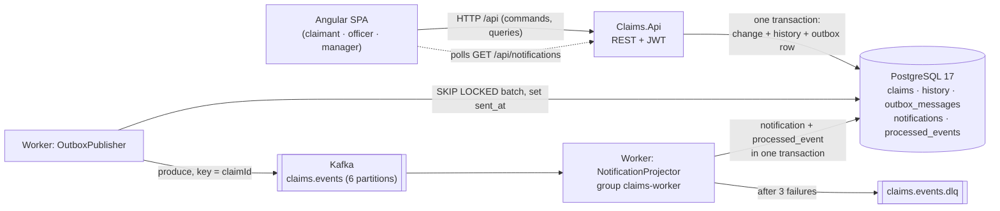
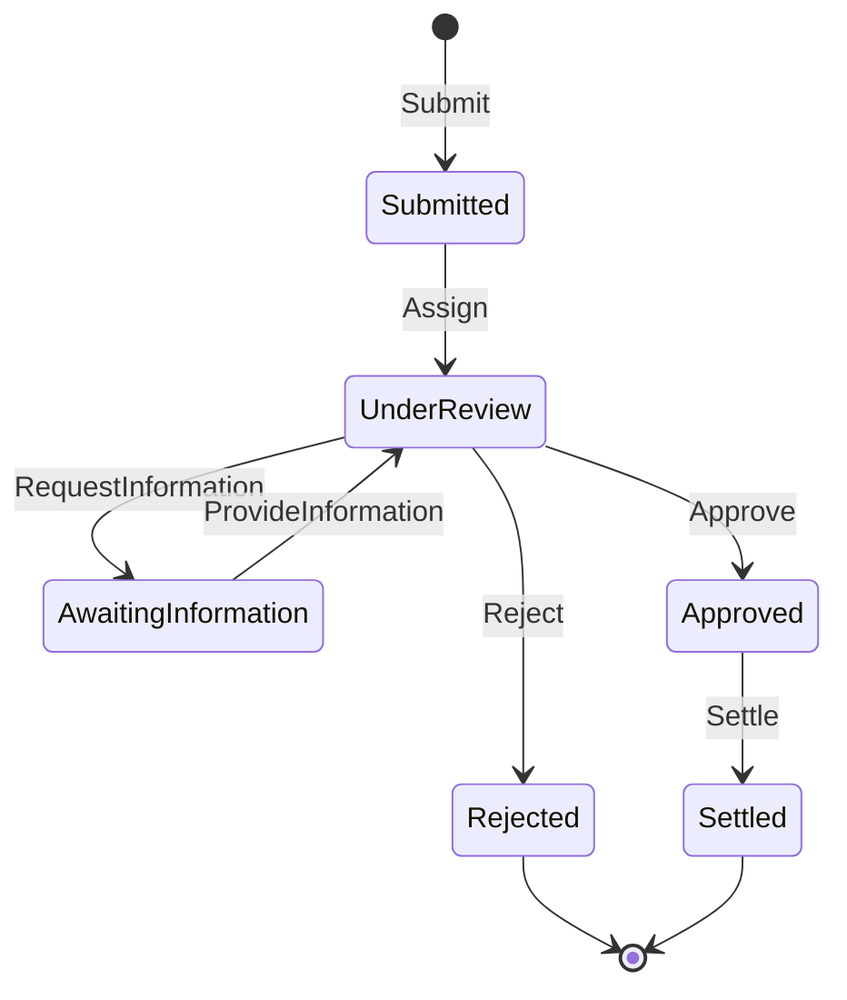

# ClaimDesk architecture

The reasons behind these choices are in [adr/](adr/). How to run the system is in the [README](../README.md).

## 1. Runtime view



- The API never talks to Kafka for events (see [ADR 0002](adr/0002-rest-for-commands-kafka-for-events.md)).
- Only the worker produces and consumes.

## 2. Layers

| Layer | Responsibility | Rules |
|---|---|---|
| Controllers (`Claims.Api`) | Route, authorize, bind the DTO, call one service method | No business logic |
| Services (`Claims.Application`) | One use case per method | Own the transaction: load, call the aggregate, `IOutbox.Enqueue`, then `SaveChanges`. Enforce *who* may act, for example a claimant only sees their own claims and only the assigned officer can decide |
| Domain (`Claims.Domain`) | The `Claim` aggregate and its state machine, `Money`, `Policy`, domain events | No packages. Throws `DomainException` |
| Repositories (`Claims.Infrastructure`) | Specific query methods | `AsNoTracking` and projection for reads. Never expose `IQueryable` |

Dependencies point inward only. `ArchitectureTests` checks this ([ADR 0001](adr/0001-modular-monolith-and-worker.md)).

## 3. Claim state machine



| Method on `Claim` | Transition | Guards (all checked before any change) |
|---|---|---|
| `Submit` | → Submitted | Claimant holds the policy. Product and currency match the policy. Policy is in force today, using the market's local date. Incident date is inside the policy period and not in the future. Amount > 0 |
| `Assign` | Submitted → UnderReview | — |
| `RequestInformation` | UnderReview → AwaitingInformation | A question is given. At most one request is open |
| `ProvideInformation` | AwaitingInformation → UnderReview | Answers the open request, matched by id |
| `RecordAssessment` | none (UnderReview only) | Reserve > 0, in the claim currency |
| `Approve` | UnderReview → Approved | Reserve recorded. Same currency. 0 < amount ≤ coverage limit − deductible, a value copied from the policy at submission |
| `Reject` | UnderReview → Rejected | Reserve recorded. Reason given |
| `Settle` | Approved → Settled | — |

- Every transition writes a `ClaimStatusHistory` row and raises a domain event.
- Any other transition throws `DomainException`, which becomes HTTP 409.
- `Status` has a private setter and only `MoveTo` writes it.
- **Open** (`Claim.OpenStatuses`) means Submitted, UnderReview or AwaitingInformation. These are the claims still
  waiting on a decision, and the SLA applies to them.
- **Closed** (`Claim.ClosedStatuses`) means Rejected or Settled.
- Approved is neither: it is decided but not yet paid. It still counts as liability exposure and as officer workload.
- **SLA:** `sla_due_at = submitted_at + 7 days`, fixed when the claim is submitted. A claim is breached when it is
  open and past `sla_due_at`.

## 4. Event catalogue

### Envelope

Each Kafka message value is one JSON envelope (`Infrastructure/Messaging/EventEnvelope.cs`). It uses web defaults:
camelCase names and enums as strings.

```json
{
  "eventId": "0193…",                 // Guid v7, unique per event: the idempotency key
  "eventType": "ClaimApproved",       // the domain event's class name
  "version": 1,                       // payload schema version
  "occurredAt": "2026-11-27T03:15:00+00:00",
  "claimId": "0193…",
  "correlationId": "4bf92f35…",       // the X-Correlation-Id or W3C trace id of the request; null for background work
  "payload": { "officerId": "…", "approvedAmount": { "amount": 1200.00, "currency": "SGD" } }
}
```

| Kafka field | Value |
|---|---|
| Topic | `claims.events` |
| Key | `claimId`, so all events of one claim go to one partition, in order |
| Headers | `eventType`, and `correlationId` when present |

### Events (version 1)

| eventType | Raised by | Payload | Notification (recipient: message) |
|---|---|---|---|
| `ClaimSubmitted` | `Submit` | `claimantId`, `policyId`, `claimedAmount{amount,currency}` | claimant: "We received your claim …" |
| `ClaimAssigned` | `Assign` | `officerId` | claimant: "…is now under review" |
| `InformationRequested` | `RequestInformation` | `requestId`, `officerId`, `question` | claimant: "We need more information…" (the question itself is not copied) |
| `InformationProvided` | `ProvideInformation` | `requestId`, `claimantId` | assigned officer: "The claimant answered…" |
| `ClaimAssessed` | `RecordAssessment` (no status change) | `officerId`, `reserve{amount,currency}` | none (internal) |
| `ClaimApproved` | `Approve` | `officerId`, `approvedAmount{amount,currency}` | claimant: "…approved for SGD 1,200.00" |
| `ClaimRejected` | `Reject` | `officerId`, `reason` | claimant: "…was not approved" (the reason is not copied) |
| `ClaimSettled` | `Settle` | `officerId`, `settledAmount{amount,currency}` | claimant: "…settled: SGD 1,200.00 paid" |

- The payload never repeats envelope fields.
- Money is always an amount together with its currency.
- Consumers mark an unknown `eventType` as processed and otherwise ignore it, so new events can be added without
  breaking existing consumers.
- A breaking payload change needs a new `version`.
- **Sources of truth:**
  - domain events: `Claims.Domain/DomainEvents.cs`
  - wire payloads: `Claims.Infrastructure/Outbox/EventPayloads.cs`, kept separate on purpose so a domain refactor
    cannot change the contract silently
  - mapping: `OutboxMessageFactory`
  - notifications: `Claims.Infrastructure/Notifications/NotificationProjection.cs`
- `OutboxMessageFactoryTests` fails if a domain event has no payload mapping.

## 5. Delivery guarantees

**Outbox publisher** (`Claims.Worker/OutboxPublisher.cs`, `Infrastructure/Outbox/OutboxDispatcher.cs`)
1. Every 1 s, in a transaction: `SELECT … WHERE sent_at IS NULL ORDER BY occurred_at LIMIT 100 FOR UPDATE SKIP LOCKED`.
2. Start all produces at once (`Acks=All`, `EnableIdempotence=true`, 5 s message timeout), then wait for them.
3. Acknowledged rows get `sent_at`. Failed rows get `attempts + 1` and `last_error`. Then commit.
4. If any row failed, or Kafka or the database is unreachable, back off exponentially from 1 s up to 30 s. A full
   batch is followed straight away by the next one.

The result is **at-least-once** delivery. If the worker crashes after Kafka acknowledged a message but before the commit, the row
is sent again ([ADR 0003](adr/0003-transactional-outbox.md)).

**Notification consumer** (`Claims.Worker/NotificationProjector.cs`)
1. Group `claims-worker`, `EnableAutoCommit=false`, starting from the earliest offset.
2. `processed_events(event_id, consumer)` and the notification are saved in one `SaveChanges`. A duplicate is skipped
   by a pre-check, or by the primary-key violation when two consumers race.
3. Commit the offset **after** the database write.
4. On failure, retry after 1 s and then 2 s, for 3 attempts in total. After that, produce the original key, value
   and headers to `claims.events.dlq`, adding `error`, `error-type`, `source-topic`, `source-partition`,
   `source-offset` and `attempts`. Then commit. If the DLQ produce fails, seek back and retry. The message is never
   skipped silently.

**Topics.** `kafka-init` in `docker-compose.yml` creates them. Automatic topic creation is off.

| Topic | Partitions | Replication | Purpose |
|---|---|---|---|
| `claims.events` | 6 | 1 | Every claim domain event |
| `claims.events.dlq` | 6 | 1 | Messages a consumer could not process after 3 attempts |

## 6. Errors, concurrency, money

- **Errors:** RFC 7807 ProblemDetails from `AddProblemDetails` and `GlobalExceptionHandler`.

  | Error | HTTP status |
  |---|---|
  | DataAnnotations validation | 400 |
  | `ForbiddenException` | 403 |
  | `NotFoundException` | 404 |
  | `DomainException` and `DbUpdateConcurrencyException` | 409 |
  | Anything else | 500, with no internal detail |

  Every ProblemDetails body includes a `correlationId` extension.
- **Concurrency:** PostgreSQL `xmin` is the row version on `claims`. Two officers assigning the same claim at the
  same moment get one 200 and one 409. The 409 comes from either the state-machine guard or the `xmin` conflict,
  depending on how the two requests interleave. An integration test covers this.
- **Money:**
  - Stored as `numeric(18,2)` plus an ISO currency code.
  - The `Money` type throws on any operation that mixes currencies.
  - The exposure report groups by currency in SQL, so it never adds different currencies together.
